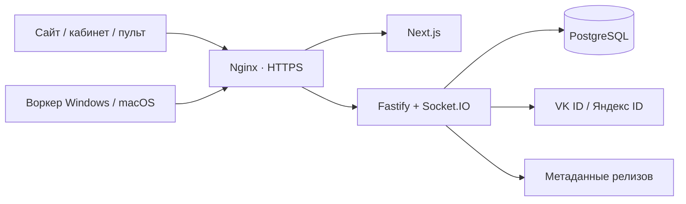

# Архитектура и технологии

## Общая схема

Один репозиторий, два серверных процесса и отдельный воркер. На первом этапе один VPS и один экземпляр API. Внешний трафик проходит через существующий Nginx.



## Стек

| Область | Решение |
|---|---|
| Сайт и кабинет | Next.js, React, TypeScript |
| UI | Tailwind CSS, shadcn/ui |
| Локализация | next-intl на сайте; общие коды и словари, отдельные словари воркера |
| API | Node.js поддерживаемой LTS-ветки, Fastify, TypeScript |
| Связь | Socket.IO для браузера и воркеров (Python-клиент на macOS, .NET-клиент на Windows) |
| Хранение | PostgreSQL, Drizzle ORM и версионированные миграции |
| Воркер macOS | Python, Quartz CGEvent, PyInstaller |
| Воркер Windows | C# / .NET 10 (LTS), SendInput, self-contained single-file exe |
| Процессы | PM2, конфигурация ecosystem.config.cjs |
| Проверки | Vitest, Playwright, pytest, xUnit (dotnet test), ESLint, Prettier |

Конкретные версии фиксируются при создании приложения в lock-файлах. На старте Redis не требуется: лимиты критичных HTTP-операций и сессии сохраняются в PostgreSQL, лимиты команд и текущие соединения — в единственном процессе API. PM2 cluster для API не включать. Перед горизонтальным масштабированием вынести общий учёт соединений и ограничений, выбрать Socket.IO adapter и проверить поведение повторных подключений.

## План структуры

```text
apps/web/              # главная, кабинет, пульт, админка
apps/api/              # HTTP API, OAuth, Socket.IO, фоновые задания
packages/contracts/    # схемы сообщений, коды ошибок, версии протокола
packages/locales/      # ru/en и проверки полноты переводов
worker/                # воркер macOS (Python) и его тесты
worker-windows/        # воркер Windows (C#/.NET) и его тесты
db/                    # схема и миграции
ops/                   # PM2, пример Nginx, инструкции релизов
docs/                  # проектная документация
```

## Модули сервера

- **Auth:** OAuth, привязки провайдеров, cookie-сессии, роли.
- **Devices:** сопряжение, владение, токены, название и статус устройств.
- **Control:** проверка доступа, управляющий сеанс, команды, подтверждения и таймеры.
- **Invitations:** временные ссылки, язык, пароль и отзыв.
- **Releases:** список сборок, совместимость, контрольные суммы и ссылки.
- **Analytics:** события, агрегирование и административные отчёты.
- **Abuse:** лимиты, блокировки и журнал защитных событий.

## Данные

Основные таблицы: `users`, `oauth_accounts`, `sessions`, `devices`, `device_credentials`, `pairing_requests`, `invitations`, `invitation_sessions`, `control_sessions`, `timers`, `worker_releases`, `download_events`, `usage_events`, `daily_metrics`, `audit_events`, `rate_limit_buckets`.

`oauth_accounts` имеет уникальный ключ `(provider, provider_user_id)`. Устройство принадлежит одному пользователю. Время хранится в UTC; язык и часовой пояс отображения не меняют значения событий. У пользователей хранится язык сайта, у приглашений — язык пульта. Токены приглашений и коды сопряжения в открытом виде не сохраняются.

## Авторизация

OAuth Authorization Code с проверкой `state`, PKCE и фиксированными разрешёнными callback URL по требованиям провайдера. Код обменивается на сервере. После проверки личности создаётся собственная отзываемая серверная сессия; cookie имеет `HttpOnly`, `Secure`, `SameSite=Lax`. Изменяющие HTTP-запросы защищены от CSRF. Для Socket.IO проверяются Origin, сессия/токен и полномочия на выбранное устройство.

Привязка OAuth-провайдера к существующему аккаунту требует активной сессии и повторной аутентификации. Запрашиваются минимальные права. Токены провайдера после входа не хранятся, если не нужны отдельной функции.

## Команды и соединения

Воркер сначала проходит привязку, затем аутентифицируется своим ключом. Имя компьютера и UUID не являются доказательством владения. Браузер получает право на устройство из аккаунта или приглашения, а сервер сам определяет маршрут команды.

Сообщение команды содержит `commandId`, действие `previous|next` и идентификатор управляющего сеанса. Сервер назначает срок действия 2 секунды. Воркер проверяет срок и отбрасывает уже выполненные `commandId`. Автоматический повтор без того же идентификатора запрещён; после потери соединения очередь нажатий очищается. Подтверждение означает выполнение системного вызова, а не подтверждение смены слайда.

WebSocket — предпочтительный транспорт; polling допускается как резервный. Повторное подключение использует экспоненциальную задержку с разбросом, от 1 до 30 секунд. При восстановлении заново проверяются доступ, управляющий сеанс и версия. Таймер сохраняется как `endAt` в PostgreSQL, браузер рисует отсчёт с поправкой на время сервера. Нулевой отсчёт не отключает управление.

## Релизы и аналитика

Публичный endpoint версии принимает ОС, архитектуру, версию приложения и протокола. Ответ включает `latestVersion`, `minSupportedVersion`, `protocolVersion`, URL, SHA-256 и ключи описания на `ru/en`. Допустимые хосты загрузок ограничены конфигурацией; данные релизов меняет только администратор. Подпись релиза проверяется публичным ключом, встроенным в воркер; SHA-256 сам по себе не заменяет подпись.

Артефакты публикуются в GitHub Releases. Сервис выдаёт ссылку через учитываемый endpoint, затем перенаправляет к файлу. Это измеряет запросы загрузки, а не завершённые скачивания. Полные загрузки можно учитывать только при наличии достоверных журналов хранилища. Массовая раздача не проходит через процесс API.

Первые запуски учитываются через случайный идентификатор установки, рабочие события — после проверки учётных данных. События имеют уникальный `eventId` для устранения повторов. Ошибка записи аналитики не блокирует переключение. Исходные события хранятся 30 дней, суточные агрегаты — 12 месяцев; очистка и агрегация идемпотентны и выполняются по расписанию.

## Основа из voteCib

Использовать как изученный образец системных нажатий, постоянной идентичности, статусов и таймера. Не переносить маршрутизацию по публичному UUID как механизм доступа, глобальный пароль и отсутствие проверки сессий Socket.IO. Код соседнего проекта не изменять в рамках разработки этого сервиса.
